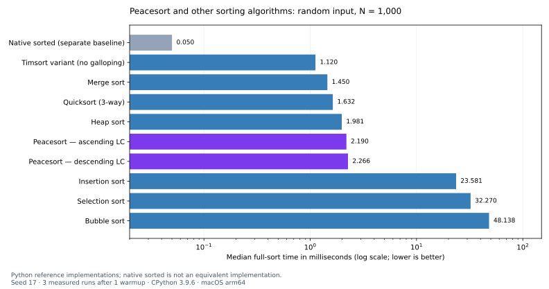

# Peacesort

Peacesort is an experimental adaptive sorting algorithm inspired by
[Stalin Sort](https://github.com/gustavo-depaula/stalin-sort) and
[r-kataria's Merciful Stalin Sort](https://github.com/r-kataria/MercifulStalinSort).
It explores a simple question: **what if every element could find a place in a
sorted subsequence, and the final result could be merged only as needed?**

Peacesort preserves every element, including duplicates. It builds monotonic
subsequences called **LCs**, then merges them through a min-heap. This repository
contains C and Python implementations, algorithm comparisons, tests, and ManimGL
visualizations. The name identifies this project; it is not a claim of research
novelty or universal performance superiority.

## Development and Concept

Stalin Sort keeps a monotonic subsequence by discarding elements that break its
order. Merciful Stalin Sort inspired the element-preserving direction: its
[documented approach](https://github.com/r-kataria/MercifulStalinSort#algorithm-overview)
extracts ordered elements through forward and backward passes, recursively sorts
the remainder, and merges the results.

Peacesort takes that inspiration toward incremental placement. Each arriving
value is assigned directly to an LC using binary search over the LC tails.
There is no recursively rejected remainder. Once input ends, a heap maintains
one candidate per LC and yields the next smallest value on demand.

The key design choices are:

- **Preserve all values:** an element either extends an LC or starts a new one.
- **Choose a construction direction:** ascending or descending LCs, with ascending final output in either mode.
- **Accept incremental input:** grow LC buffers as values arrive, without knowing the total length beforehand.
- **Merge lazily:** consume a prefix, pause, and resume from the same iterator.

Incremental input does not mean immediate globally sorted output. Arbitrary
input must end before output begins, because a later value could be smaller
than everything received so far. All values remain stored in memory.

## Algorithm Overview

### 1. Partition into LCs

In ascending mode, LC tails are kept in nonincreasing order. For each value `x`,
binary search finds the first LC whose tail is at most `x`. Append there, or
create a new LC if none qualifies.

```text
Input: [3, 1, 4, 2, 5, 6]

LC 1:  [3, 4, 5, 6]
LC 2:  [1, 2]
```

Descending mode reverses the placement comparisons and builds nonincreasing
LCs. Those LCs are read backward during merging. Either mode accepts mixed
input correctly; a poor direction choice affects efficiency, not correctness.

### 2. Prepare the Merge Heap

After input ends, place the smallest remaining value from each LC into a
min-heap. In ascending mode this is the first element; in descending mode it is
the last. Heap construction takes O(m), where `m` is the number of LCs.

### 3. Yield Sorted Values on Demand

Pop the smallest candidate, advance within its LC, and repair the heap.

```text
First request:   [1, 2, 3]
Next request:    [4, 5, 6]
Combined output: [1, 2, 3, 4, 5, 6]
```

Only requested outputs are merged. The iterator retains its state between
requests. Each LC is internally ordered, so the smallest remaining value must
be among the heap candidates. Every value enters one LC and is yielded once.

## Time Complexity Analysis

Let `n` be the input size, `m` the number of LCs, and `K` the number of requested
outputs. Bounds assume constant-cost key comparisons and amortized buffer growth.

| Operation | Time |
| --- | --- |
| Build all LCs | O(n log(m + 1)) |
| Build the merge heap | O(m) |
| Yield the first K values | O(K log(m + 1)) after construction |
| Fully sort | O(n log(m + 1)) |
| Additional storage | O(n) values and O(m) metadata |

### Best Case: O(n)

Matching monotonic input forms one LC: ascending input in ascending mode, or
descending input in descending mode. All-equal input also forms one LC. Input
construction and full output are then linear.

### Worst Case: O(n log n)

At most one new LC is created per value, so `m <= n`. Binary-search placement
and heap merging therefore give an O(n log n) worst-case bound. No assumption
about geometrically shrinking recursive partitions is needed.

There is no single average-case claim here without specifying an input
distribution. The useful adaptive parameter is the LC count. For example,
interleaving a small number of individually increasing sequences while
preserving their internal order allows a small number of ascending LCs.

### Partial Output and Tradeoffs

Stopping after K values saves the remaining merge work, but not input ingestion
or storage. If K is known and small, a dedicated size-K heap may use much less
memory. A full min-heap also supports resumable output; Peacesort differs by
keeping one heap candidate per LC rather than per remaining input element.

## Empirical Results and Analysis

The benchmark compares Peacesort with insertion, bubble, selection, quick,
merge, heap, and a Timsort variant on random, ascending, descending, duplicate,
nearly sorted, mixed-direction, and all-equal inputs.

The following local run used **N=1,000, seed 17, one warmup, and three measured
repetitions**, with CPython 3.9.6 on macOS 26.5.1 arm64. All 210 measured outputs
were checked against the expected sorted result. These are full-sort reference
implementation timings, not language-independent rankings or production C results.



| Algorithm | Random | Ascending | Descending | Duplicates |
| --- | ---: | ---: | ---: | ---: |
| Peacesort / ascending LC | 2.190 | 0.350 | 4.421 | 1.087 |
| Peacesort / descending LC | 2.266 | 4.135 | 0.369 | 1.132 |
| Insertion | 23.581 | 0.078 | 44.974 | 22.177 |
| Bubble | 48.138 | 0.065 | 57.171 | 46.037 |
| Selection | 32.270 | 30.359 | 31.210 | 32.249 |
| Quick / 3-way | 1.632 | 3.195 | 2.540 | 0.587 |
| Merge | 1.450 | 0.907 | 0.934 | 1.443 |
| Heap | 1.981 | 2.055 | 1.831 | 1.876 |
| Timsort / no galloping | 1.120 | 0.115 | 0.120 | 1.117 |
| Native sorted / separate baseline | 0.050 | 0.003 | 0.004 | 0.042 |

Times are median milliseconds; lower is better. Both Peacesort directions are
reported rather than choosing the faster one afterward. The Timsort reference
omits galloping and merge-boundary trimming, so it is not a substitute for
production Timsort measurements. Native `sorted` is a separate runtime baseline.

### Random Arrays

In this run, Peacesort was faster than insertion, bubble, and selection, but
slower than the quicksort, mergesort, and Timsort reference variants. The LC
search and heap merge still perform substantial work when many LCs are needed.

### Sorted and Reverse-Sorted Arrays

Matching the LC direction reduced the work substantially compared with choosing
the opposite direction. That does not make Peacesort the fastest method on
monotonic input: other adaptive implementations also exploit existing order.
The explicit stream direction matters; it is not chosen by a best-result oracle.

### Partially Sorted and Duplicate Arrays

Repeated values can keep the LC count small. In this run, Peacesort was
competitive with several reference implementations on the duplicate workload.
For partially sorted input, the result depends on the actual disorder pattern;
a percentage of displaced elements alone does not determine the LC count.
The benchmark also includes nearly sorted and mixed-direction cases.

### Reproduce the Comparison

```sh
python3 algorithm/benchmarks/compare.py --sizes 1000 --repeats 3 --warmups 1 --seed 17
```

The runner writes raw samples, timing summaries, key-comparison counts, runtime
metadata, and a Markdown report to `algorithm/benchmarks/comparison_results/`.
These generated files are ignored by Git. For larger runs, use
`--sizes 100 1000 10000`; quadratic algorithms are skipped above 2,000 unless
`--quadratic-limit` is increased. See the [benchmark methodology](algorithm/benchmarks/README.md).

No direct Merciful Stalin Sort benchmark is included yet. Inspiration and
structural differences do not establish a measured speed advantage over it.

## Potential Improvements

### Record and Key Support

The current implementations sort integers. Supporting records, custom keys,
and an explicit stability policy would make log and event processing experiments
more representative of real applications.

### Memory and Merge Efficiency

Measure peak memory, reduce per-LC allocation overhead, and explore freeing
consumed storage. These changes should preserve the resumable iterator behavior.

### Broader Workload Evaluation

Test real datasets, multiple seeds, larger inputs, and varying output prefixes.
Compare partial output with size-K heaps, selection algorithms, and full
min-heaps. Add a direct, reproducible comparison with Merciful Stalin Sort.

## Conclusion

Peacesort combines element-preserving subsequence construction with resumable
heap merging. Its most promising use is input that forms relatively few LCs,
followed by consumption of a variable-length sorted prefix. The current results
support continued experimentation, not replacing established sorting routines
for every workload.

## Quick Start

### Python

Python 3.9+; no third-party packages are needed for the algorithm. Run from the
repository root:

```python
from itertools import islice
from algorithm.python.peacesort import (
    PEACESORT_ASCENDING, PeacesortStream, peacesort,
)

stream = PeacesortStream(PEACESORT_ASCENDING)
for value in [3, 1, 4, 2, 5, 6]:
    stream.push(value)
stream.finish()

print(list(islice(stream, 3)))  # [1, 2, 3]
print(list(islice(stream, 3)))  # [4, 5, 6]
stream.close()

print(peacesort([3, 1, 2]))     # [1, 2, 3]
```

Use `PEACESORT_DESCENDING` for descending LC construction. Both modes output
ascending values. `peacesort_iter(values, direction)` consumes an iterable once
and returns a ready iterator; its default direction is ascending. Built-in
integers of arbitrary precision are accepted, excluding booleans. Invalid
values raise `TypeError`; invalid lifecycle operations raise `RuntimeError`.
Repeated `finish()` does not rewind, and `close()` releases unfinished or
partially consumed storage. Allocation failures propagate as `MemoryError`.

### C

Include [`peacesort.h`](algorithm/include/peacesort.h) and compile with
[`peacesort.c`](algorithm/src/peacesort.c). Values use `int64_t`.

```c
PeacesortIterator *it = peacesort_stream_create(PEACESORT_ASCENDING);
if (!it) return -1;

int64_t input[] = {3, 1, 4, 2, 5, 6};
for (size_t i = 0; i < 6; ++i) {
    if (peacesort_push(it, input[i]) < 0) {
        peacesort_destroy(it);
        return -1;
    }
}
if (peacesort_finish(it) < 0) {
    peacesort_destroy(it);
    return -1;
}

int64_t value;
int status;
while ((status = peacesort_next(it, &value)) == 1) {
    /* Consume value, or stop early and keep the iterator to resume later. */
}
peacesort_destroy(it);
if (status < 0) return -1;
```

`peacesort(data, n, output)` is the eager convenience function. It returns 0 on
success and -1 on error; input and output may overlap. Constructors return NULL
on failure, with `errno` set. Failed pushes and finishes can be retried after
allocation failure. `peacesort_next` returns 1 for a value, 0 for exhaustion,
and -1 for invalid use. See the header for the complete contract.

The C array API samples up to 512 evenly spaced elements for inputs larger than
128 values to choose forward or reverse insertion. The stream API and Python
API honor the supplied direction instead. Neither implementation promises
stable ordering for equal-key records.

### Tests

```sh
python3 -B -m unittest discover -s algorithm/tests -p 'test_*.py' -v

cc -O2 -std=c11 -Wall -Wextra -Wpedantic -Ialgorithm/include \
  algorithm/src/peacesort.c algorithm/tests/test_sort.c -o /tmp/peacesort-test
/tmp/peacesort-test

cc -O2 -std=c11 -Wall -Wextra -Wpedantic -Ialgorithm/include \
  algorithm/tests/test_alloc.c -o /tmp/peacesort-alloc-test
/tmp/peacesort-alloc-test
```

## Visualizations

Watch the [N=2,000 comparison with slower early playback](demo/videos/PeacesortComparisonAll_N2000_Slow.mp4),
the [six-panel comparison](demo/videos/PeacesortComparison.mp4), or the
[nine-panel comparison](demo/videos/PeacesortComparisonAll.mp4).

These animations share a **key-comparison budget, not a wall-clock timing scale**.
The nine-panel scene includes both Peacesort directions, quick, merge, heap,
insertion, bubble, selection, and the Timsort variant. At large N, displayed bars
average adjacent values, while the algorithms still sort all input values.

To run ManimGL scenes, use Python 3.12+ and the demo environment:

```sh
cd demo
uv sync
uv run manimgl peacesort_comparison.py PeacesortComparisonAll

PEACESORT_N=2000 PEACESORT_SECONDS=90 PEACESORT_FRAMES=360 \
  PEACESORT_TIMELINE=focus PEACESORT_HOLD=1.5 \
  uv run manimgl peacesort_comparison.py PeacesortComparisonAll -w --video_dir videos
```

`PEACESORT_PATTERN` accepts `random`, `ascending`, `descending`, `near`,
`duplicates`, or `mixed`. Other controls are `PEACESORT_N` (4–2,000),
`PEACESORT_SEED`, `PEACESORT_FRAMES` (2–600), and `PEACESORT_SECONDS` (1–120).
Focus mode expands the early range when comparison counts differ substantially;
`PEACESORT_HOLD` pauses at completions. Use `PEACESORT_TIMELINE=linear` for a
constant comparison rate. Frame rounding and holds add to the requested duration.

Detailed Peacesort scenes are available in `peacesort_manim_demo.py`:
`PeacesortStepByStep`, `PeacesortOverview`, and `PeacesortTopKDemo`.
`peacesort_manim_interactive_style.py` provides the separate `PeacesortVisualizer`
scene; see its docstring for controls.

## Project Structure

```text
algorithm/
  src/          C implementation
  include/      C API
  python/       Python implementation
  tests/        Correctness, failure handling, and trace tests
  benchmarks/   Algorithm comparisons and methodology
demo/           ManimGL scenes, environment, and rendered videos
docs/           README benchmark chart
```

## Acknowledgments and Contributions

Peacesort was inspired by Stalin Sort and Merciful Stalin Sort. Credit goes to
[r-kataria](https://github.com/r-kataria) for Merciful Stalin Sort and its
[project write-up](https://github.com/r-kataria/MercifulStalinSort), which also
inspired the organization of this README. The
[Stalin Sort community repository](https://github.com/gustavo-depaula/stalin-sort)
provides implementations of the original idea across many languages.

Bug reports, counterexamples, reproducible benchmarks, and implementation
improvements are welcome through issues and pull requests. If you find this
experiment useful, consider starring the repository.
